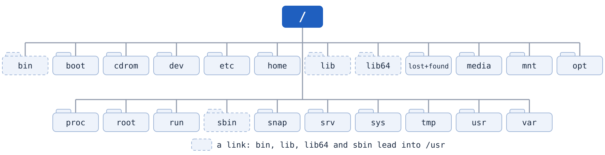

# OS Lab 2 — Linux Navigation & File Management (Hands-on)

| Item | Details |
|---|---|
| Duration | 120 minutes in class. Before class: about 20 minutes to read [Concepts First](#concepts-first) and do the pre-lab |
| Work | Individual. Your file names and folders are different from your neighbour's |
| Environment | Shared Ubuntu server with an individual account for each student. Local Linux/WSL works for practice ([setup](../SETUP.md)) |
| Tools | `pwd`, `ls`, `cd`, `mkdir`, `cp`, `mv`, `cat`, `find`, `cmp`, `oslab` |
| Lab format | Pilot: personal values, Core / Plus / Challenge, live checkpoint |
| Lecture link | [Week 2 notes: OS structures and interfaces](../../lectures/notes/week02-os-structures-interfaces.md) |

> **Scenario:** Two reports arrived in TechCorp's `incoming` folder. You must put them in the right places in the company's folders, keep their contents unchanged, and be able to reach them from any department.

## Lab Objectives

After the Core, you can:

1. Move around with absolute and relative paths, and explain `.` and `..`.
2. Build a folder tree, then move and copy files without changing their contents.
3. Find the cause of a path error and prove that a copy is identical.

## How This Lab Works

| Command | What it does |
|---|---|
| `oslab values lab2` | Shows **your** file names and folders. Use them everywhere in this lab |
| `oslab predict lab2` | Saves your prediction once, before the experiment |
| `oslab hint lab2 1` | Gives a hint (levels 1, 2, 3). Hints cost no points |
| `oslab check lab2` | Looks at your folders and shows your milestones |
| `oslab checkpoint lab2` | Opens when the instructor says so, near the end |

- **Core** is for everyone. **Plus** and **Challenge** are for students who finish early. Full marks need only Core and the checkpoint.
- AI tools are allowed in Core, Plus and Challenge. They are **not** allowed in the prediction and the checkpoint.
- In Core 2 nobody gives you the commands. You write every path yourself.

## Before the Lab

Do this before class. It takes about 20 minutes.

1. Read [Concepts First](#concepts-first) below, and try its examples in your home folder on the server.
2. Then check the helper and answer the three pre-lab questions.

   ```bash
   oslab doctor
   oslab prelab lab2
   ```

## Concepts First

This section explains the ideas the lab uses, with examples. The examples use a practice folder in your home, not the lab files. Your instructor goes through it again at the start of the class.

### 1. One tree that starts at `/`

Linux keeps every file in **one tree of folders**. A folder is also called a **directory**; the two words mean the same thing. The top of the tree is the **root**, written `/`. There are no drive letters like `C:` in Windows: a second disk or a USB stick appears as a folder somewhere inside the same tree.

```text
/                 the root: everything is below it
├── bin/          programs everybody can run: ls, cp, mv, ...
├── etc/          settings of the system (configuration files)
├── home/         one home folder for each user
│   ├── student/
│   └── another-student/
├── tmp/          temporary files, deleted at restart
└── usr/          installed software
```

Those are the folders you meet in this course. The real list is longer. Ubuntu made every folder in `/` when it was installed, and each has its own job. This is `ls /` on the course server, drawn with the root at the top:



| In `/` | What it is for |
|---|---|
| `/bin` | Link to `/usr/bin`: the programs everybody uses, such as `ls`, `cp` and `mv` |
| `/boot` | The kernel and the files that start the system |
| `/cdrom` | Where an installation disc appears. Left over from installing Ubuntu |
| `/dev` | Devices shown as files: disks, terminals, `/dev/null` |
| `/etc` | Settings of the system (configuration files), for example `/etc/passwd` |
| `/home` | One home folder for each user |
| `/lib`, `/lib64` | Links to `/usr/lib` and `/usr/lib64`: libraries that programs need |
| `/lost+found` | Pieces of files rescued by a disk check. Only `root` can open it |
| `/media` | USB sticks and DVDs appear here when they are plugged in |
| `/mnt` | A place where the administrator attaches a disk for a while |
| `/opt` | Optional software installed outside the package manager |
| `/proc` | Not on the disk: the kernel shows running processes here, for example `/proc/cpuinfo` |
| `/root` | The home of the administrator account, `root`. It is not the root `/` |
| `/run` | Information about the system since it started. Kept in memory |
| `/sbin` | Link to `/usr/sbin`: programs for the administrator |
| `/snap` | Software installed as snap packages (Ubuntu) |
| `/srv` | Data that this server offers, for example a website |
| `/sys` | Not on the disk: the kernel shows devices and its settings here |
| `/tmp` | Temporary files. Every user may write here. Emptied at restart |
| `/usr` | Installed software: programs in `/usr/bin`, libraries in `/usr/lib`, documents in `/usr/share` |
| `/var` | Data that changes: logs in `/var/log`, mail, caches |
| `swap.img` | A file, not a folder: disk space used as extra memory (swap) |

Try `ls /` and `ls -l /` yourself. In `ls -l /`, a line that starts with `l` is a link, and `->` shows where it leads, for example `bin -> usr/bin`. You can look into most of these folders, but only the administrator may change them.

### 2. Your home directory

Every account has its own **home directory**: `/home/` followed by the account name. On the server, an account named `student` has the home `/home/student`. When you log in, you start there. You may create files only in your home (and in `/tmp`).

Three ways to write the same home:

| You write | It means |
|---|---|
| `/home/student` | the full name of the home of `student` |
| `~` | your own home, whoever you are |
| `$HOME` | the same, as a shell variable |

`cd` with nothing after it takes you home from anywhere. The prompt shows `~` while you are at home, and the real folder when you are somewhere else:

```text
student@server:~$ pwd
/home/student
student@server:~$ cd /etc
student@server:/etc$ pwd
/etc
student@server:/etc$ cd
student@server:~$ pwd
/home/student
```

Your lab folder is `~/oslab-work/lab2`. Its full name is `/home/YOUR_ACCOUNT/oslab-work/lab2`. Follow the blue line from the root down to it:


### 3. Absolute and relative paths

A **path** is the list of folders you walk through to reach a file, separated by `/`. There are two kinds:

- An **absolute path** starts with `/`. It starts at the root, so it means the same place from anywhere.
- A **relative path** does not start with `/`. It starts from the folder you are in now, which `pwd` shows. So its meaning changes when you move.

Take this example tree in the home of `student`:

```text
/home/student
├── Documents/
│   └── School/
│       ├── Art/
│       │   └── poster.txt
│       └── Math/
│           └── homework.txt
└── Downloads/
    └── photo.jpg
```

The same files, reached from different folders:

| You are in (`pwd`) | You want | Absolute path | Relative path |
|---|---|---|---|
| `/home/student` | `poster.txt` | `/home/student/Documents/School/Art/poster.txt` | `Documents/School/Art/poster.txt` |
| `/home/student/Documents/School` | `poster.txt` | `/home/student/Documents/School/Art/poster.txt` | `Art/poster.txt` |
| `/home/student/Documents/School/Math` | `poster.txt` | `/home/student/Documents/School/Art/poster.txt` | `../Art/poster.txt` |
| `/home/student/Documents/School/Art` | `photo.jpg` | `/home/student/Downloads/photo.jpg` | `../../../Downloads/photo.jpg` |

The absolute path is the same in every row. The relative path changes, because it starts from where you are.

### 4. Four special names

| Name | Means | Example |
|---|---|---|
| `.` | the folder you are in now | `cp /tmp/a.txt .` copies `a.txt` into the folder you are in |
| `..` | the folder **one level above** the one you are in | `cd ..` goes up one level |
| `../..` | two levels above | `cd ../..` goes up two levels |
| `~` | your home | `cd ~/oslab-work` |

`..` always counts from the folder you are in now. It does not mean "my home" or "the lab folder". In the last row of the path table, from `Art`, the first `..` is `School`, the second is `Documents`, and the third is `/home/student`.

### 5. Names with spaces

The shell splits a command into words at every space. A file name with a space must be quoted, or the command receives two names:

```text
student@server:~$ cat my notes.txt
cat: my: No such file or directory
cat: notes.txt: No such file or directory
student@server:~$ cat 'my notes.txt'
hello
```

In this lab your file names have spaces, and you keep them in shell variables, for example `file1='budget 2026.txt'`. Write the variable inside double quotes, `"$file1"`: the shell replaces it with your file name and keeps it as one word. Single quotes keep text exactly as typed, so `'$file1'` would not be replaced.

Some commands in this lab have `--` before the file names, as in `cp -- "$file1" reports/`. It means "no more options after this point", so a file name that starts with `-` is still read as a name.

### 6. File and folder commands

| Command | What it does | Example |
|---|---|---|
| `pwd` | Prints the folder you are in | `pwd` |
| `ls` | Lists a folder | `ls`, `ls Documents` |
| `ls -l` | Long list: permissions, size, date | `ls -l` |
| `ls -a` | Also lists hidden names, which start with `.` | `ls -a` |
| `ls -R` | Lists every folder below as well (recursive) | `ls -R Documents` |
| `ls -lt`, `ls -lS`, `ls -lh` | Sorts by time, by size, or shows sizes like `4.0K` | `ls -lh` |
| `cd` | Changes folder | `cd Documents`, `cd ..`, `cd` |
| `mkdir` | Makes a folder | `mkdir Art` |
| `mkdir -p` | Makes the whole chain of folders, with no error if they exist | `mkdir -p School/Art/old` |
| `touch` | Makes an empty file | `touch notes.txt` |
| `cat` | Shows what is in a file | `cat notes.txt` |
| `cp` | Copies a file. The original stays | `cp a.txt b.txt`, `cp a.txt Art/` |
| `cp -r` | Copies a folder with everything in it | `cp -r Art Art-backup` |
| `mv` | Moves a file to another folder, or renames it | `mv a.txt Art/`, `mv a.txt b.txt` |
| `rm` | Deletes a file. There is no recycle bin | `rm b.txt` |
| `rmdir` | Deletes an empty folder | `rmdir old` |
| `find` | Lists everything below a folder. `-type f` keeps only files, `-type d` only folders | `find School -type f` |
| `cmp` | Compares two files byte by byte. Prints nothing when they are identical | `cmp a.txt Art/a.txt` |
| `nano` | A simple text editor in the terminal | `nano notes.txt` |

When the destination of `cp` or `mv` is a folder, the file keeps its name inside that folder. When it is a new name, the file gets that name.

`cat` can show several files one after the other: `cat a.txt b.txt`. When two files differ, `cmp` says where the first difference is, for example `a.txt b.txt differ: byte 3, line 1`.

In `nano`, type your text, then press `Ctrl+O` and `Enter` to save, and `Ctrl+X` to leave. The keys are listed at the bottom of the screen; `^` means `Ctrl`.

### 7. Sending output somewhere else: `>`, `|` and `tee`

Normally a command prints its output on the screen. Three signs send it somewhere else:

| You type | What happens |
|---|---|
| `ls > list.txt` | `>` saves the output in the file `list.txt` instead of the screen. It replaces what was in the file (Lab 1) |
| `ls >> list.txt` | `>>` adds the output to the end of the file (Lab 1) |
| `ls \| sort` | `\|`, the **pipe**, passes the output of `ls` to the next command, `sort`, which puts the lines in order |
| `ls \| tee list.txt` | `tee` shows the output on the screen **and** saves it in `list.txt` |

A pipe can join more than two commands. Read it from left to right:

```text
student@server:~$ find demo -type f | sort | tee files.txt
demo/School/Art/poster.txt
demo/School/Math/copy.txt
```

`find` lists the files, `sort` puts them in order, and `tee` shows the list and saves it in `files.txt`. You use exactly this in Core 3.

Try them together in a practice folder in your home:

```text
student@server:~$ mkdir -p demo/School/Art demo/School/Math
student@server:~$ cd demo/School
student@server:~/demo/School$ echo 'draft' > Art/poster.txt
student@server:~/demo/School$ cp Art/poster.txt Math/
student@server:~/demo/School$ mv Math/poster.txt Math/copy.txt
student@server:~/demo/School$ cmp Art/poster.txt Math/copy.txt
student@server:~/demo/School$ ls -R
.:
Art  Math

./Art:
poster.txt

./Math:
copy.txt
student@server:~/demo/School$ cd ../..
student@server:~$ pwd
/home/student
```

`cmp` printed nothing, so the copy is identical. When you are done, delete the practice folder from your home with `rm -r demo`. `rm -r` deletes a folder and everything inside it, with no undo, so run `pwd` first and type the name carefully.

## Timetable

| Minutes | Activity |
|---|---|
| 0–5 | Setup |
| 5–20 | Guided: where am I? |
| 20–30 | Prediction, then class discussion |
| 30–40 | Core 1: build the company folders |
| 40–65 | Core 2: move and copy with your own paths |
| 65–75 | Core 3: prove it |
| 75–90 | Plus and Challenge (or finish Core) |
| 90–105 | Live checkpoint |
| 105–115 | Debrief |
| 115–120 | Submit |

## Setup (0–5)

1. Start the lab and go into its folder.

   ```bash
   export OSLAB_WORKSPACE="${OSLAB_WORKSPACE:-$HOME/oslab-work}"
   oslab start lab2
   cd "$OSLAB_WORKSPACE/lab2"
   mkdir -p evidence
   oslab values lab2
   ```

   The first line gives the shell variable `OSLAB_WORKSPACE` the value `~/oslab-work`, the folder where `oslab` keeps your labs; `${OSLAB_WORKSPACE:-...}` keeps an earlier value if you already set one. `export` lets the `oslab` command see the variable too. You do not need to change this line: type it as it is.

2. Type **your** values into shell variables. A variable is a name that holds a value: write `name=value` with **no spaces** around `=`. The values below are only an example. Keep the quotes: your file names have a space in them.

   ```bash
   file1='budget 2026.txt'
   file2='audit notes.txt'
   owner=Finance
   reader=HR
   third=Support
   ```

   If you open a new terminal, run `cd` and set these variables again.

3. **Understand the variables and the placeholders.** After step 2 the shell replaces `"$file1"` with your first file name, and `"$owner"` with your owner department. Where this instruction cannot use a variable, it writes the value's name in angle brackets, like `<owner>`. Never type the brackets: type your own value, or the variable in double quotes.

   | The instruction says | With the example values above, you type | Or, with the variable |
   |---|---|---|
   | `ls -l "incoming/$file1"` | `ls -l 'incoming/budget 2026.txt'` | `ls -l "incoming/$file1"` |
   | `TechCorp/<owner>/` | `TechCorp/Finance/` | `"TechCorp/$owner/"` |
   | `TechCorp/<reader>/` | `TechCorp/HR/` | `"TechCorp/$reader/"` |

4. Your folder looks like this, with your own two file names:

   ```text
   lab2/
   ├── incoming/
   │   ├── (your file1)
   │   └── (your file2)
   ├── reports/
   │   └── README.txt
   └── evidence/
   ```

## Guided — Where Am I? (5–20)

Your instructor first goes through [Concepts First](#concepts-first) with the guide, for about five minutes. Then type along.

1. See where you are and what is here.

   ```bash
   pwd
   ls
   ls -la
   ```

   `pwd` prints an **absolute path**: it starts with `/`. In `ls -la`, the first two lines are `.` (this folder) and `..` (the folder above).

2. Work in a practice folder, so you do not touch the reports yet.

   ```bash
   mkdir -p practice/notes
   echo 'orientation' > 'practice/welcome note.txt'
   cd practice
   pwd
   cp -- 'welcome note.txt' notes/
   cat 'notes/welcome note.txt'
   cd ..
   pwd
   ```

   `echo` with `>` writes the text into a new file, as in Lab 1. `--` after `cp` means "no more options", so a file name is never taken for one. `cd ..` goes to the parent folder. Always check with `pwd`.

3. Read one file in two ways.

   ```bash
   cat 'practice/welcome note.txt'
   cat "$OSLAB_WORKSPACE/lab2/practice/welcome note.txt"
   ```

   Which of the two commands stops working if you `cd` somewhere else?

4. See why the quotes matter. The second command fails. Read its error message.

   ```bash
   ls -l "incoming/$file1"
   ls -l incoming/$file1
   ```

   Without the double quotes, the shell splits your file name at its space, so `ls` looks for two files that do not exist.

## Prediction (20–30)

```bash
oslab predict lab2
```

Answer alone, without AI, before the experiment. A wrong prediction costs nothing. The class will look at the spread of answers together.

## Core 1 — Build the Company Folders (30–40)

1. Go back to the lab folder and create the tree for your departments.

   ```bash
   cd "$OSLAB_WORKSPACE/lab2"
   mkdir -p "TechCorp/$owner/archive" "TechCorp/$reader" "TechCorp/$third"
   find TechCorp -type d
   ```

   One `mkdir -p` makes all three departments, and `archive` inside the owner department. `find TechCorp -type d` lists every folder below `TechCorp`, so you can see the tree you made.

2. Read the two incoming reports and write down their contents. You will need them to prove that nothing changed. `cat` with two names shows the first file, then the second.

   ```bash
   cat "incoming/$file1" "incoming/$file2"
   ```

## Core 2 — Move and Copy With Your Own Paths (40–65)

Write each command yourself. Run `pwd` before every command that moves or copies. Write every command that worked into `evidence/paths.txt`: from the lab folder, open it with `nano evidence/paths.txt`, type or paste the command, save with `Ctrl+O` and `Enter`, and leave with `Ctrl+X`.

`<owner>` and `<reader>` are your own values from `oslab values lab2` (see the table in Setup). Use the variables in double quotes, as in `"$file1"`, so the names with spaces stay one word.

1. Go **into** `incoming/`. Move your first file to `reports/` with a **relative** destination.
2. Go back to the lab folder. Move your second file to `reports/` with **absolute** paths for both source and destination. Start them with `"$OSLAB_WORKSPACE/lab2/…"`.
3. Copy both reports from `reports/` into your owner department, `TechCorp/<owner>/`. The originals must stay in `reports/`.
4. Copy your first report into `TechCorp/<owner>/archive/` with the new name `first-original.txt`.
5. Go **into** your reader department, `TechCorp/<reader>/`. Without leaving it, read the first report in the owner department: once with a relative path and once with an absolute path.
6. **Your decision:** for step 3, did you use relative or absolute paths? Write in `evidence/paths.txt` which you chose and when the other kind would be better.

Stuck for more than five minutes? Use `oslab hint lab2 1`, then `2`, then `3`.

## Core 3 — Prove It (65–75)

1. A name in `ls` does not prove the contents are the same. Compare the bytes. `cmp` prints nothing when two files are identical, and says where they first differ when they are not.

   ```bash
   cd "$OSLAB_WORKSPACE/lab2"
   cmp -- "reports/$file1" "TechCorp/$owner/$file1"
   cmp -- "reports/$file2" "TechCorp/$owner/$file2"
   ```

2. Make one path error on purpose: from your reader department, try to read the report with a path that would only work from the lab folder. Copy the error message into `evidence/paths.txt` and write one line that explains it.
3. Save the final list of files and check your milestones.

   ```bash
   cd "$OSLAB_WORKSPACE/lab2"
   find incoming reports TechCorp -type f | sort | tee evidence/tree.txt
   oslab check lab2
   ```

   Read the first line from left to right (see [Concepts First](#concepts-first), part 7): `find` lists every file in the three folders, the pipe `|` passes the list to `sort`, which puts it in order, and `tee` shows it on the screen and saves it in `evidence/tree.txt`.

**Core is complete when** `oslab check lab2` shows `milestones: 4/4`.

## Plus — Find the Lost File (75–90)

1. Create a small mess.

   ```bash
   cd "$OSLAB_WORKSPACE/lab2"
   mkdir -p mess/a/b mess/c
   echo 'lost' > 'mess/a/b/lost file.txt'
   ```

2. Go into `mess/c`. Without any `cd`, move `lost file.txt` into the folder you are in and rename it `found.txt`, with **one** command.
3. From inside `mess/a/b`, copy `found.txt` into your third department under `TechCorp/`, using only a relative path. How many `..` did you need?
4. Save both commands and the count in `evidence/plus.txt`.

## Challenge

In a file name, `*` stands for any characters, so `*.txt` means every name that ends in `.txt`. The shell replaces it with the matching names before the command runs. Lab 3 explains it fully.

Copy every `.txt` file from `reports/` into your third department with **one** command that uses `*`. Then answer in `evidence/challenge.txt`:

- Why does the command fail if you put quotes around `*.txt`?
- Create `reports/.hidden.txt`. Does your command copy it? Why?

## Live Checkpoint (90–105)

Wait until the instructor opens it. Close AI tools. Work alone.

```bash
oslab checkpoint lab2
```

1. Answer the questions. They use a new starting folder and a new target, made for you at this moment.
2. Then do what the command prints, and save the output in `evidence/checkpoint.txt`. It prints a line with `cat … | tee …`: `cat` shows the file, and `tee` also saves what it shows (see [Concepts First](#concepts-first), part 7).
3. Run `oslab check lab2`. A fifth milestone, `checkpoint`, must pass.

## Debrief (105–115)

Look at your prediction again. `oslab` saved your answers in a hidden folder, `.records`, in your workspace. The file is in JSON, a text format of names and values.

```bash
cat "$OSLAB_WORKSPACE/.records/lab2-predict.json"
```

In your report, write **confirmed** or **corrected** for each answer, and explain in 3–5 sentences why a correct file name can still give "No such file or directory".

## Submit (115–120)

1. Copy your work to your course repository. Replace `YOUR_ID` with your own ID. `SUBMISSION_REPO` is a variable like `file1`: it keeps the long path, so the next two lines stay short.

   ```bash
   SUBMISSION_REPO="$HOME/os-gic-YOUR_ID/os-lab-YOUR_ID"
   mkdir -p "$SUBMISSION_REPO/lab2/evidence"
   cp -- evidence/paths.txt evidence/tree.txt "$SUBMISSION_REPO/lab2/evidence/"
   ```

2. Fill in the [report template](README.md) as `lab2/README.md`. Add `checkpoint.txt`, and `plus.txt` or `challenge.txt` if you did them.

   ```text
   lab2/
   ├── README.md
   └── evidence/
       ├── paths.txt   # your commands, your decision, and one explained error
       └── tree.txt    # the final list of files
   ```

3. Commit and push, as in Lab 1. `git pull` comes first, in case you pushed from your own computer since.

   ```bash
   cd ~/os-gic-YOUR_ID
   git pull
   git add os-lab-YOUR_ID/lab2
   git commit -m "Lab 2"
   git push
   ```

## Grading Criteria (10 points)

| Evidence | Points |
|---|---:|
| Correct folders and files: `oslab check lab2` passes the four Core milestones | 2 |
| Tests: identical copies with `cmp`, and one path error explained | 2 |
| Prediction saved in time, and an honest confirmed/corrected explanation | 2 |
| Live checkpoint: answers, the saved output, and your sentence | 3 |
| Clear, complete evidence files and report | 1 |

Plus and Challenge are not needed for full marks. They are noted in your feedback. Your prediction is marked for being made and corrected, not for being right.

## Help and References

- `oslab hint lab2 1`, `2`, `3`
- `man mv`, `man cp`, `man find`
- Old wider topics (system directory tour, larger company tree, listing options) are in the [optional extensions](extensions.md).
