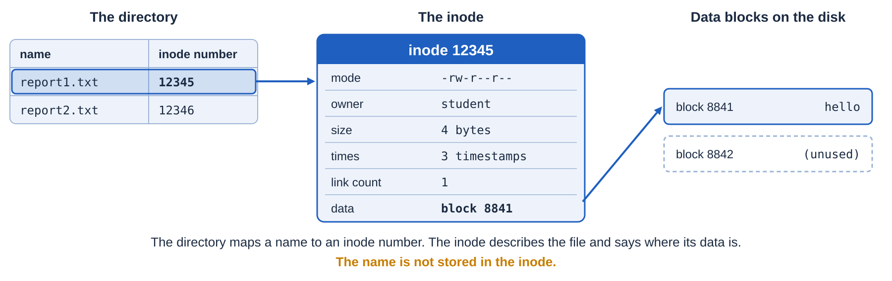
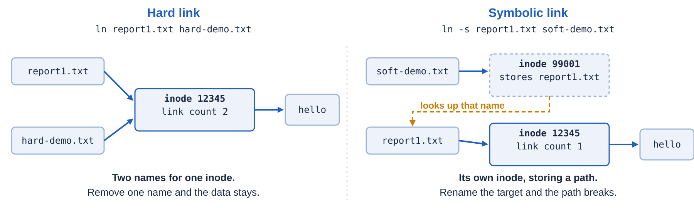

# OS Lab 3 — Wildcards, Hard Links and Symbolic Links

| Item | Details |
|---|---|
| Course | Operating Systems, Institute of Technology of Cambodia |
| Duration | 120 minutes |
| Ownership | Individual work and submission |
| Primary environment | Shared Ubuntu server with an individual account for each student |
| Prerequisites | Lab 2: changing directories, relative paths, copying and moving files |
| Required tools | Bash, Python 3, `ln`, `ls`, `readlink`, `stat`, `mv` |
| Practice fallback | Local Linux/WSL; see [setup](../SETUP.md) |
| Optional work | GRUB and shared libraries are in [extensions](extensions.md); they are not graded in this core |

You maintain a report that other names refer to. Today you will rename the report, find out which references break, repair a symbolic link, and create a different file using the old name.

## Lab Objectives

By the end, you should be able to:

1. Explain which filenames a Bash wildcard selects and what quoting changes.
2. Use inode numbers to distinguish a hard link from a separate copy.
3. Explain and repair a symbolic link after its target is renamed.

## How This Lab Works

A few small helper commands (`oslab`) save your answers and check your files. They are the same ones you used in Labs 1 and 2.

| Command | What it does |
|---|---|
| `oslab prelab lab3` | Three short questions before class. A wrong answer costs nothing; read the explanation |
| `oslab predict lab3` | Saves your prediction once, **before** the experiment |
| `oslab hint lab3 1` | A hint. Use level 1, then 2, then 3. Hints cost no points |
| `oslab check lab3` | Checks your files and shows what is still missing |
| `oslab checkpoint lab3` | A short test near the end. It opens when the instructor says so |
| `oslab debrief lab3` | After the experiment: you give the right answers to your prediction questions |

- The **core** (Tasks 1 and 2) is for everyone. **Plus** and **Challenge** are optional for students who finish early. Full marks need only the core and the checkpoint.
- AI tools are allowed in the tasks, Plus and Challenge. They are **not** allowed in the prediction and the checkpoint. Always test what an AI tells you.

## Before the Lab

Do this before class. It takes about 10 minutes.

```bash
oslab doctor
oslab prelab lab3
```

## Task Overview and 120-minute Timetable

| Minutes | Activity |
|---|---|
| 0–10 | Introduction, objectives and setup |
| 10–25 | Guided example: commands and observations |
| 25–35 | Submit a prediction using `oslab` |
| 35–70 | Rename, repair and create a new file with the old name |
| 70–85 | Check the results and fix incomplete work |
| 85–100 | Individual changed-case checkpoint; no AI or peers |
| 100–110 | Compare prediction with results and explain the difference |
| 110–120 | Submit the short report and evidence |

## Lab Setup (0–10 minutes)

1. Log in with **your own account**. Run `oslab doctor`. It must say **class inbox: connected** for your instructor to receive your answers. If it says **practice mode**, tell the instructor before the prediction. Your answers are saved locally, but are not sent to the class board.
2. If `oslab` is unavailable, follow [the setup guide](../SETUP.md). Start the lab and enter its directory:

   ```bash
   export OSLAB_WORKSPACE="${OSLAB_WORKSPACE:-$HOME/oslab-work}"
   oslab doctor
   oslab start lab3
   cd "$OSLAB_WORKSPACE/lab3"
   pwd
   mkdir -p evidence
   find . -maxdepth 3 -type f
   ```

3. Check the starting files. `links/source.txt` contains `version 1`. Leave `.oslab-managed.json` intact; the helper uses it to recognize your workspace. `target-name.txt` is a spare fixture file and is not used in the core.

   ```text
   lab3/
   ├── .oslab-managed.json
   ├── links/
   │   ├── source.txt
   │   └── target-name.txt
   └── evidence/
   ```

`oslab start` preserves existing work. If you are resuming, inspect your files before repeating commands that create or rename them. Do not reset the lab just to fix one link. No task in this core needs `sudo`.

## Task 1 — Wildcards: Guided Example (10–25)

**Starting directory:** the `lab3` root. This practice folder is separate from the report in `links/`.

1. Create two text files and one log file:

   ```bash
   mkdir -p practice
   printf 'one\n' > practice/report1.txt
   printf 'two\n' > practice/report2.txt
   printf 'log\n' > practice/report.log
   ls practice
   ```

2. Run these commands **before creating the demo links in step 3**. The braces group the commands; `tee` displays their output and saves it in one file.

   ```bash
   {
     printf '<%s>\n' practice/*.txt
     printf '<%s>\n' practice/report?.txt
     printf '<%s>\n' 'practice/*.txt'
   } | tee evidence/wildcards.txt
   ```

   `*` matches any sequence of characters; `?` matches exactly one character. Bash expands an unquoted pattern into matching filenames before running `printf`. Quotes keep the last pattern literal.

   **Record in your report:** Which two names does the first command print? Does the second print the same names? Why does the third print a `*` instead of filenames? Use the filenames above in your answer.

3. Create a hard link and a symbolic link to `report1.txt`:

   ```bash
   ln practice/report1.txt practice/hard-demo.txt
   ln -s report1.txt practice/soft-demo.txt
   ls -li practice/report1.txt practice/hard-demo.txt practice/soft-demo.txt
   readlink practice/soft-demo.txt
   ```

   `ls -li` shows the inode number in its first column. On the same filesystem, two hard-linked names identify the same inode and the same file data. A symbolic link has its own inode and stores a target path; `readlink` prints that path.

   A **relative symbolic-link target starts from the directory containing the link**. Here `soft-demo.txt` is inside `practice/`, so the stored target `report1.txt` means `practice/report1.txt`. Storing `practice/report1.txt` would incorrectly look for `practice/practice/report1.txt`.

   **Check together:** Compare the inode numbers of `report1.txt` and `hard-demo.txt`. Then compare the symbolic link's number. These observations introduce the experiment; no extra screenshot or written answer is required here.

   

   

## Prediction (25–35)

**Do this before Task 2, alone and without AI.** You are predicting the following sequence, not running it yet:

- `links/source.txt` contains `version 1`.
- You create `hard.txt` with `ln source.txt hard.txt` and `soft.txt` with `ln -s source.txt soft.txt` inside `links/`.
- You rename `source.txt` to `renamed.txt`.
- Later you create a **new** `source.txt` containing `version 2`.

Submit your answers in the terminal:

```bash
oslab predict lab3
oslab status lab3
```

The helper asks whether each link works after the rename, which version the hard link reads after the new file is created, and one sentence explaining your reasoning. It saves your first prediction and sends it to the instructor's inbox. **Do not create or upload a separate prediction file.** `status` confirms it was saved. A wrong prediction does not lose accuracy points; you will explain your result at the end.

In local practice, the record is `$OSLAB_WORKSPACE/.records/lab3-predict.json`; it stays on your machine. On the class server, the instructor sees it on the board and website. If you see “collects its prediction on paper”, the installed helper needs updating; tell the instructor.

## Task 2 — Hard Links and Symbolic Links (35–70)

Work through these five steps in order. Keep the names shown so the automatic checker can find the files.

### 1. Create the references and record the starting state

Enter `links/`. Check that `source.txt` still contains `version 1`, then make the links. `tee` starts your evidence file; later commands append to it.

```bash
cd "$OSLAB_WORKSPACE/lab3/links"
cat source.txt
ln source.txt hard.txt
ln -s source.txt soft.txt
{
  printf '\n=== BEFORE RENAME ===\n'
  ls -li source.txt hard.txt soft.txt
  printf 'hard.txt: '; cat hard.txt
  printf 'soft.txt: '; cat soft.txt
  printf 'stored target: '; readlink soft.txt
} | tee ../evidence/links.txt
```

**Check:** All three names should read `version 1`. `source.txt` and `hard.txt` should have equal inode numbers. If `ln` says `File exists`, inspect the existing entry; do not overwrite work blindly.

### 2. Rename the source and observe the failure

You are still in `links/`. Rename the original, then read each reference:

```bash
mv -- source.txt renamed.txt
{
  printf '\n=== AFTER RENAME, BEFORE REPAIR ===\n'
  ls -li renamed.txt hard.txt soft.txt
  printf 'hard.txt: '; cat hard.txt
  printf 'stored target: '; readlink soft.txt
  printf 'soft.txt: '; cat soft.txt
} 2>&1 | tee -a ../evidence/links.txt
```

The `cat soft.txt` error is **expected**. The link still exists, but the path it stores no longer names an existing file. This is a *dangling symbolic link*. `2>&1` includes the error message in the saved evidence.

**Record in your report:** What target does `readlink soft.txt` print at this point, and which filename is now missing? Answer about this state, before the repair or the new `source.txt` exists.

### 3. Repair only the symbolic link

Make `soft.txt` point to `renamed.txt` using a **relative** target. Write the two commands yourself: remove the owned `soft.txt` entry with `rm -- soft.txt`, then create the symbolic link again with `ln -s TARGET soft.txt`. Replace `TARGET` with the path from the link's folder to the renamed file.

Do not delete or recreate `hard.txt`. Do not rename `renamed.txt` back. Run `cat soft.txt`: it should now print `version 1`.

### 4. Save the repaired state

Still in `links/`, append the repaired link's target, inode numbers and file contents:

```bash
{
  printf '\n=== AFTER REPAIR ===\n'
  ls -li renamed.txt hard.txt soft.txt
  printf 'stored target: '; readlink soft.txt
  printf 'hard.txt: '; cat hard.txt
  printf 'soft.txt: '; cat soft.txt
} | tee -a ../evidence/links.txt
```

**Check:** `renamed.txt` and `hard.txt` still share an inode. The repaired symbolic link reads `version 1` through its stored path.

### 5. Reuse the old filename for a different file

Only `renamed.txt`, `hard.txt` and the repaired `soft.txt` refer to the original report now. Create a **new** `source.txt` and save the comparison:

```bash
printf 'version 2\n' > source.txt
{
  printf '\n=== NEW FILE USING THE OLD NAME ===\n'
  ls -li source.txt renamed.txt hard.txt soft.txt
  printf 'source.txt: '; cat source.txt
  printf 'hard.txt: '; cat hard.txt
  printf 'soft.txt: '; cat soft.txt
} | tee ../evidence/replacement.txt
```

**Record in your report:** Give the inode numbers of the new `source.txt` and `hard.txt`, and the version each prints. Explain why creating a new file under the old name does not change the file that `hard.txt` refers to. Your repaired `soft.txt` should still refer to `renamed.txt`.

## Tests and Feedback (70–85)

Return to the lab root and run the checker:

```bash
cd "$OSLAB_WORKSPACE/lab3"
oslab check lab3
```

Before the checkpoint it checks **four milestones**: wildcard output, hard-link identity, the repaired symbolic target, and the new source's distinct identity/content. Read each `TRY` explanation, fix that item, and run the check again. The check sends results to the instructor; it does not automatically award your whole grade.

| State in your evidence | Expected result |
|---|---|
| Before rename | Both links read `version 1`; source and hard link share an inode |
| After rename, before repair | Hard link reads `version 1`; symbolic link is dangling |
| After repair | Symbolic link resolves to `renamed.txt` and reads `version 1` |
| After creating a new source | New source reads `version 2`; both links still read `version 1` |

The checker inspects your current files. The labelled sections in `evidence/links.txt` show the earlier failure and repair; your teacher reviews those rather than asking you to repeat the whole experiment. Keep links inside the managed lab folder.

## Plus and Challenge (optional)

Do these only if the core is finished and `oslab check lab3` shows no `TRY` line. They are not needed for full marks. They use their own folder, `extra/`, and their own file, `evidence/plus.txt`, so your core files stay as the checker expects them.

**Plus — one more wildcard.** In the `lab3` root, add square brackets: `[12]` matches one character, either `1` or `2`.

```bash
cd "$OSLAB_WORKSPACE/lab3"
printf '<%s>\n' practice/report[12].txt
printf '<%s>\n' practice/report[!1].*
```

`[!1]` means "any one character except `1`". Before you run them, write down which names you expect each command to print. Then run them, and write one sentence in `evidence/plus.txt` about any difference between your guess and the result. Hint: the second pattern needs one character, then a dot, then anything.

```bash
printf 'Plus: my answer is ...\n' > evidence/plus.txt
```

**Challenge — a chain of links.** Make a link that points to another link, then find where it ends.

```bash
mkdir -p extra
cd extra
printf 'chain end\n' > end.txt
ln -s end.txt middle.txt
ln -s middle.txt start.txt
ls -l start.txt middle.txt
readlink start.txt
readlink -f start.txt
cat start.txt
cd ..
```

`readlink` prints one step. `readlink -f` follows the whole chain. What happens to `cat start.txt` if you rename `end.txt`? Predict first, then test it inside `extra/` only, and add your answer to `evidence/plus.txt`:

```bash
printf 'Challenge: my answer is ...\n' >> evidence/plus.txt
```

## Individual Changed-case Checkpoint (85–100 minutes)

Work alone, with AI tools closed. When the instructor announces that the checkpoint is open, run:

```bash
oslab checkpoint lab3
```

The helper describes a **separate folder**, an existing data file and a symbolic link with an incorrect target. It asks two short answers and one explanation, then prints a small file task using your assigned names. Submit the answers in the terminal; then follow the printed task and run `oslab check lab3` again. A fifth milestone checks the checkpoint files. Do not change your Task 2 files.

**Practice example:** A folder `lab3/checkpoint-maple/` contains `note.txt`. A link `shortcut.txt` in that same folder stores `../note.txt`, but `lab3/note.txt` does not exist. Does the link work? What relative target should it store instead? Which folder is the starting point for resolving the stored path?

The public example is practice; the helper supplies the names for your own case. The first class answer is retained. In local practice the checkpoint is available without an instructor release, and the teacher does not receive it.

## Explanation and Correction (100–110 minutes)

Run `oslab debrief lab3` to answer the prediction questions again **after** the experiment. It keeps the original prediction unchanged and sends your corrected answers to the instructor.

In the [short report](README.md), complete the three specific answers from Tasks 1 and 2. End with **confirmed** or **corrected** and one sentence connecting your prediction to an observed result. Use your actual filenames, inode numbers and version text; no general essay is needed.

## Cleanup and Final Submission (110–120 minutes)

There are two submission routes, each with a clear purpose:

| What | Where it goes | How |
|---|---|---|
| Prediction, check results, checkpoint answers and debrief | Instructor's class inbox | Sent by the `oslab` commands above; confirm with `oslab status lab3` |
| Short report and three text evidence files | `lab3/` in your personal course Git repository | Copy the files, commit and push below |

1. Set `SUBMISSION_REPO` to your **existing personal course repository**, using your own ID. Use the [README template](README.md) to create `lab3/README.md` there; keep an existing report if you are resuming.

   ```bash
   SUBMISSION_REPO="$HOME/os-gic-YOUR_ID/os-lab-YOUR_ID"
   mkdir -p "$SUBMISSION_REPO/lab3/evidence"
   cd "$OSLAB_WORKSPACE/lab3"
   cp -- evidence/wildcards.txt evidence/links.txt evidence/replacement.txt "$SUBMISSION_REPO/lab3/evidence/"
   oslab status lab3
   ```

2. Check that your submission has this structure:

   ```text
   lab3/
   ├── README.md
   └── evidence/
       ├── wildcards.txt    # two expanded patterns and one quoted literal
       ├── links.txt        # labelled before / renamed / repaired states
       └── replacement.txt  # new source versus original hard-linked file
   ```

3. In your personal repository, run `git status --short`, add only the intended Lab 3 files, then commit and push using the course submission procedure. Your `oslab` records are already collected; do not copy private record folders or submit screenshots of every command.
4. Keep the practice workspace until grading is complete. `oslab clean lab3` is optional afterwards and removes only the managed workspace. The core creates no background jobs, mounts or boot configuration changes.

## Grading Criteria (10 points)

| Evidence mapped to lab objectives | Points |
|---|---:|
| Wildcard result, hard-link identity and repaired symbolic target: 1 point each | 3 |
| Labelled rename/failure/repair evidence and recreated-name comparison: 1 point each | 2 |
| Original prediction saved, followed by debrief and an evidence-based correction: 1 point each | 2 |
| Individual checkpoint: path answers and working repaired link: 1 point each | 2 |
| Complete short report and three evidence files submitted | 1 |

The board and website summarize the objective checks and saved answers. The teacher reviews your short explanations and the labelled failure/repair record; a helper `PASS` alone does not prove the earlier sequence or your understanding. Incorrect initial predictions are not penalized. Equivalent valid target paths earn credit; the named files are used so the checker can locate the result. If you use different names, show the teacher the equivalent files for manual review.

AI is optional during Tasks 1–2 and tests, and excluded from the prediction and checkpoint. If used, add one sentence naming a suggestion and how you checked it. No chat history is required.

## Help, References and Optional Work

Use `man ln` and `man readlink` for command syntax. If a link fails, inspect `readlink`, locate the link's own directory, then resolve the stored target from there. The [visual guide](guides/slides.html) illustrates the concepts and follows these steps, including the terminal prediction, checkpoint and submission; if the two ever differ, **this instruction governs**. GRUB and library tasks in [extensions](extensions.md) are optional and do not affect the core grade.
